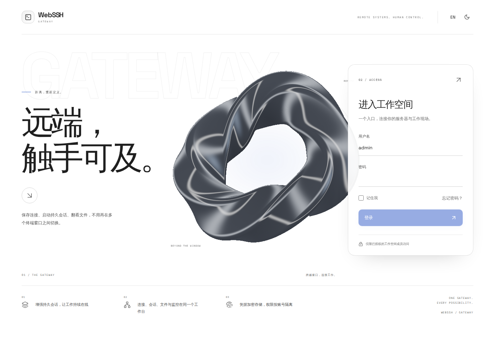
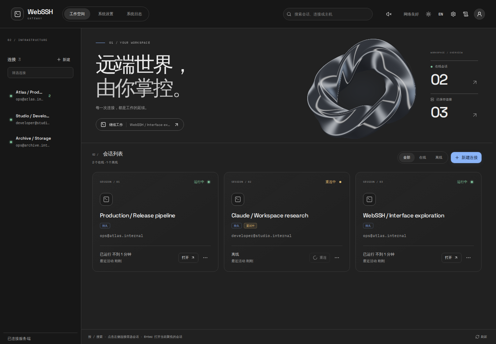
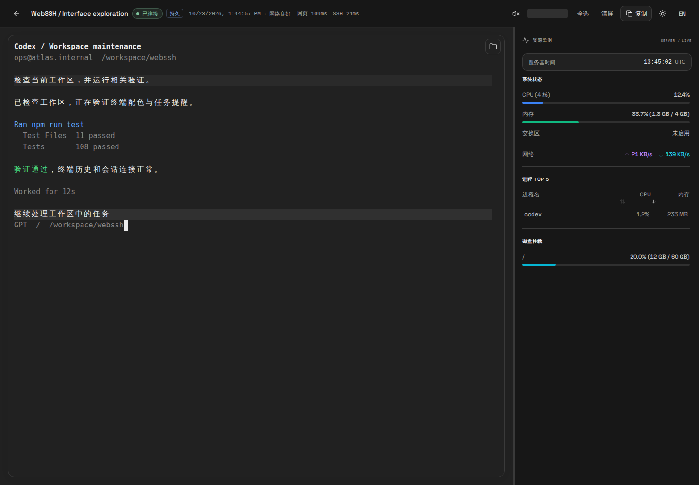
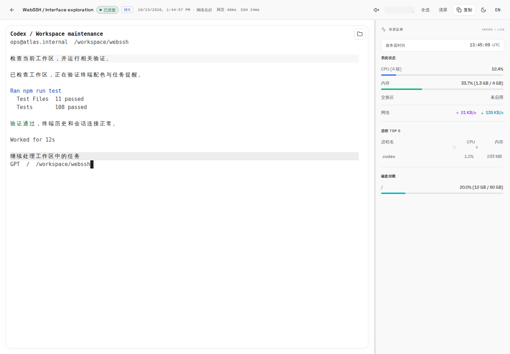
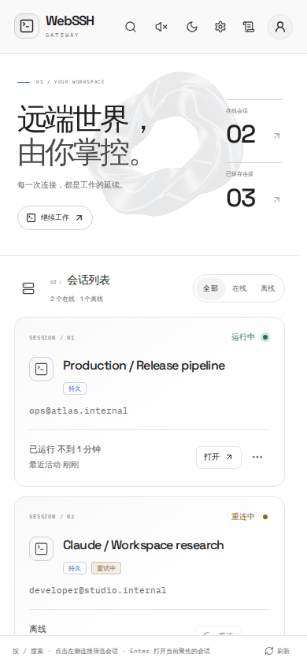
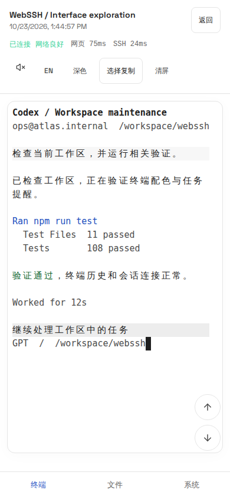
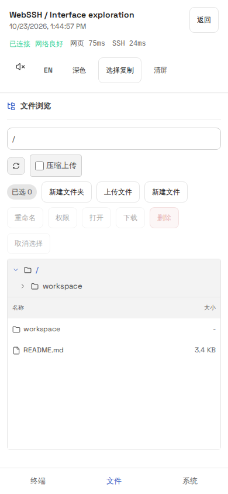

# WebSSH Gateway

> English version: [README.en.md](./README.en.md)

WebSSH Gateway 是一个面向运维、开发和 AI CLI 工作流的浏览器 SSH 网关。可以在网页中使用 Codex、Claude Code 等终端工具，并管理 SSH 连接、文件和服务器状态。

其中一个核心特点是面向长时任务的“持久会话设计”。基于增强会话与 `tmux` 保活能力，即使浏览器关闭、网络抖动或前端页面刷新，后台任务仍可持续运行，适合执行需要保活的部署/巡检脚本、AI Code（自动化编码）长流程开发、定期数据监控与日志采集等场景。

本仓库重点优化终端历史滚动、大范围拖选、深浅色即时切换，以及 CLI 本轮结束和等待用户操作时的声音提醒。同一会话的近期输出和通知记录可以在其他设备上查看。

界面以“Gateway / 远端入口”为视觉主题：大幅文字版式、原创金属立体图形、响应指针的弹簧动效，以及本地字体。工作空间提供会话卡片、连接筛选和“继续工作”入口；登录、终端、文件、监控、设置和日志共用中性炭灰／纯白配色、克制的蓝色强调色与 Lucide 图标。终端深色底为 `#212121`、浅色底为 `#ffffff`，TUI 面板与选区随主题即时切换。立体图形在交互停止后停止动画，图形能力受限时使用本地图片，尊重系统的“减少动态效果”设置。

[快速开始](#快速开始) · [CLI 任务提醒](#cli-任务提醒) · [架构说明](./docs/ARCHITECTURE.md) · [部署指南](./docs/DEPLOYMENT.md)

## 项目预览

以下为当前界面截图，使用演示数据。








## 移动端适配

移动端提供专门的触摸友好布局与交互，支持在手机浏览器中完成终端操作、文件管理与系统监控。





## 核心特性

- Web 端 SSH 终端：基于 WebSocket 的实时交互终端。
- 延迟诊断：点击顶部网关延迟，分别查看浏览器到网关往返、网关到 SSH 目标、网关回包排队、两端调度迟到及浏览器输出处理/绘制等待。各项采样范围不同，不能直接相减得到纯网络延迟；调度迟到显示近 5 秒最大值，后台标签页不参与浏览器采样。
- 持续输出按每个浏览器的解析确认控制发送进度，避免未处理数据在浏览器里大量积压；输入和延迟探测不等待输出确认。新旧前后端可兼容，完整诊断和输出控制需同时更新前后端。
- AI CLI 输出优化：有序分批传输与渲染，连续输出时保持阅读位置，重连时重置并回放近期输出。
- 终端选择复制：拖动到边缘可继续选择；有选区时 `Ctrl+C` 复制，无选区时仍发送中断；支持 `Ctrl+Shift+C` / `Cmd+C` 快捷复制。系统设置可调整当前浏览器的终端历史行数，默认 10,000 行。
- 终端使用 xterm 6 的原生同步重绘，优先硬件 WebGL，受限时回退到 DOM。滚轮位移略降至 0.85 倍并保留触控板小数余量；跨屏拖选在边缘停留可逐渐加速，高亮与完整画面保持同步；浏览已有历史时保持阅读位置，持续输出仍可同步到其他设备。
- 终端深浅色即时切换：在浏览器中适配 TUI 的中性面板背景，浅色模式加深彩色文字及淡化的次级信息；Codex 等程序可保持运行，已有内容、选区和新输出跟随当前主题显示。
- CLI 任务提醒：本轮结束与提问／批准使用不同提示音，支持试听、音量调整、跨会话接收、多标签页去重及跨设备未读同步。启用步骤和兼容条件见 [CLI 任务提醒](#cli-任务提醒)。
- 连接资产管理：支持保存主机连接信息，密码/私钥凭据加密存储。
- 会话生命周期管理：会话状态跟踪、断开重连、会话备注。
- 会话分组视图：会话列表支持按连接/机器分组，支持列表/分组视图切换、展示偏好记忆，以及在分组头部预览在线机器状态。
- 增强会话持久化：支持基于 `tmux` 的持久会话设计、增强保活与自动重试机制。
- 精简 SSH 服务兼容：增强持久化组件在 SFTP 不可用时自动回退到 SSH 数据流上传，兼容 OpenWrt、Dropbear 等环境。
- 移动端适配：面向手机浏览器的触摸友好操作与布局。
- 移动端终端选择复制：支持从本地终端输出快照中长按选择并复制局部文本，打开时会近似保持当前阅读位置。
- 系统监控面板：CPU、内存、网络、进程、磁盘等实时查看。
- 系统日志查看：会话管理页提供“日志”入口，可查看当前后端进程最近运行日志，便于排查登录、会话和系统接口问题。
- 文件管理能力：浏览、上传、下载、重命名、删除、权限修改、批量上传。
- 粘贴图片缓存：系统设置中可按 SSH 连接查看临时图片、占用空间和到期时间，支持预览、下载、删除及手动清理过期图片。默认保留 3 天，可切换为 7 天；后台启动时及每小时清理过期图片，终端关闭后仍生效，离线目标会在后续检查时重试。兼容旧版 `/tmp/webssh-clipboard.*` 图片，仅删除当前远程账号拥有的缓存图片；同一 SSH 账号共享缓存，需要长期保留的图片请先下载。删除保存的连接后，网关将无法继续为该连接执行清理。
- 基础安全能力：JWT 鉴权、密码复杂度校验、登录失败锁定、请求追踪 ID 日志。

## 技术栈

- 后端：FastAPI + SQLAlchemy + AsyncSSH + SQLite
- 前端：React + TypeScript + Vite + TailwindCSS + xterm.js
- 部署：Docker / Docker Compose

## CLI 任务提醒

### 支持哪些提醒

| 场景 | 提醒方式 |
| --- | --- |
| 主会话本轮回复结束 | 一声短音 |
| 等待回答、选择或批准操作 | 两声短音，并显示来源会话 |
| 中间命令、工具或子任务完成 | 不作为主会话整轮完成提醒 |
| 其他终端程序发出的通用响铃 | 可单独开启，默认关闭 |

“本轮回复结束”表示 CLI 结束当前一轮响应，不代表每项操作都成功。提醒依据 CLI 的通知或状态事件，不根据对话中的关键词、问号或输出静默时间猜测。

### 首次启用

1. 登录网关，打开已连接的 SSH 终端。
2. 点击顶部的 **任务提醒与声音**，选择 **开启声音并试听**，确认当前设备可以播放声音。
3. 点击 **接入 CLI 提醒**，为目标服务器的当前 SSH 用户配置 Codex 通知和 Claude Hook。接入会备份并合并已有配置，不会自动重启正在运行的 CLI。
4. 查看当前运行中的 CLI 接入状态。已有会话会尝试直接接入；Codex 使用共享后台进程、无法明确对应会话记录时，选择 **绑定此会话**。Claude 支持在运行中加载新增 Hook，可通过 `/hooks` 查看。
5. 按需调整完成音、提问／批准音、音量和“仅离开当前网页时响铃”。新设备默认音量为 60%；已有设备保留保存的音量，可点击 **使用推荐音量 60%**。声音开关需自行启用，前台与后台均可提醒。

接入属于目标 SSH 用户的 CLI 配置；声音开关和音量属于当前设备。可以通过 **检查接入** 查看状态，通过 **撤销接入** 移除本功能的自动配置；需要立即静音时关闭 **播放提示音**。

接入记录、配置文件检查和当前会话的事件验证分别显示。“配置已验证”不等于当前会话已发出通知；收到真实事件后，对应能力才显示“已验证”。Linux 目标通过当前终端进程识别已有 CLI；Codex 完成提醒可监听其已有会话记录中的明确结束事件，提问／批准仍依赖原生等待状态。不从对话文字或输出停顿猜测。接入和重连从记录末尾开始，不补响历史任务。无法读取记录或无法确定归属时会显示原因；在同一 CLI 中切换对话后，如提示重新绑定，请重新选择当前会话。

### 自动接入要求

以下版本已在本地隔离的 CLI 与 tmux 测试中验证；更高版本仍需保持兼容的通知接口。

| 工具 | 自动接入最低版本 | 目标服务器环境 |
| --- | --- | --- |
| Codex CLI | 0.163.0 | Python 3.11+，用于读取和保留 TOML 配置 |
| Claude Code | 2.1.306 | Python 3.8+ |
| 其他 CLI | 取决于工具是否发出终端通知或响铃 | 不保证区分完成和提问，可使用通用响铃 |

增强会话会接入 tmux 状态转发。已有自定义输出管道时会保留它并停止自动接入，不会覆盖。自定义 Stop／继续执行 Hook 可能影响完成通知，需要单独验证；检测到其他用户或项目 Stop Hook 时，会优先依赖原生结束信号，避免提前报完成。

### 通知记录与使用范围

- 切换到其他会话或会话管理页后，网页仍可接收提醒；点击提醒可进入来源会话。
- 通知及已读状态由网关保存，在同一账号的设备之间同步；声音偏好按设备保存。同一浏览器中的多个标签页会协调播放，避免同一事件重复响铃。
- 最近通知每个账号最多保留 200 条、保留 7 天；刷新、重连和加载旧记录不会集中补响。
- 此保留期限仅适用于通知记录。终端近期输出和浏览器历史缓冲仍按现有配置工作，未增加 7 天终端输出归档。
- 网页需要保持打开并正常运行。浏览器冻结、设备休眠或锁屏、网页关闭以及网关 SSH 断开时，不保证即时播放；当前没有后台推送或系统桌面通知。

## 快速开始

> 重要安全提示：部署前务必修改 `.env` 中的 `SECRET_KEY` 与 `INITIAL_ADMIN_PASSWORD`（不要使用示例值或弱口令），否则会显著降低会话与鉴权安全性，并导致首次管理员初始化失败。

### 方式 1：本地开发部署

请阅读 [docs/DEPLOYMENT.md](./docs/DEPLOYMENT.md) 中“本地开发部署”章节。

### 方式 2：从本仓库构建 Docker 镜像

使用本仓库的滚动、配色和任务提醒改动时，请从本仓库源码构建镜像。

```bash
git clone https://github.com/yu8008/web-ssh-new.git
cd web-ssh-new
cp .env.example .env

# 先修改 .env 中的 SECRET_KEY 和 INITIAL_ADMIN_PASSWORD，再构建、启动
docker build -t webssh-gateway:local .

docker run -d \
  --name webssh-gateway \
  --restart unless-stopped \
  -p 8080:8080 \
  --env-file .env \
  -v webssh-data:/data \
  webssh-gateway:local
```

启动后访问 `http://服务器地址:8080`，使用 `admin` 和配置的初始密码登录，首次登录后按提示修改密码。

已有部署应沿用原有 `.env` 和数据卷，通过原来的部署流程重新构建并更新容器。仅推送 GitHub 或构建前端，不会更新已经运行的 Docker 容器。

原文档提到的 [beibeizi/websshgateway 镜像](https://hub.docker.com/r/beibeizi/websshgateway) 由上游维护，不保证包含本仓库新增功能。更完整的开发与部署说明见 [docs/DEPLOYMENT.md](./docs/DEPLOYMENT.md)；需要本仓库改动时，按上面的源码构建方式部署。

## 文档导航

- 架构说明： [docs/ARCHITECTURE.md](./docs/ARCHITECTURE.md)
- 开发与部署： [docs/DEPLOYMENT.md](./docs/DEPLOYMENT.md)
- 贡献指南： [CONTRIBUTING.md](./CONTRIBUTING.md)
- 英文文档： [README.en.md](./README.en.md)

## 目录结构

```text
.
├── backend/                  # FastAPI 后端
├── frontend/                 # React 前端
├── session-transfer-files/   # 增强会话所需二进制文件
├── docs/                     # 项目文档
├── .env.example              # 环境变量示例
├── Dockerfile                # 镜像构建
├── docker-compose.yml        # 本地容器编排
└── LICENSE
```

## License

本项目基于 [Apache-2.0 License](./LICENSE) 开源。
