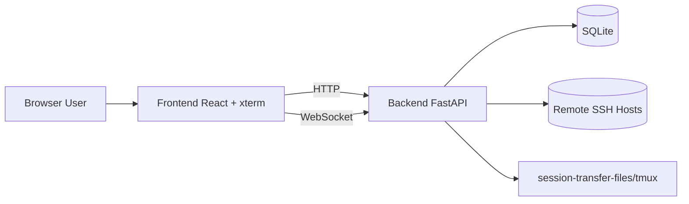

# Architecture (Community Edition)

> 中文版请见：[ARCHITECTURE.md](./ARCHITECTURE.md)

## 1. Overview

WebSSH Gateway follows a frontend-backend architecture:

- Frontend: user interaction, terminal UI, file and monitoring panels
- Backend: authentication, session orchestration, SSH bridge, and APIs

## 2. Backend Modules

- `app/main.py`: app bootstrap and route mounting
- `app/api/`: REST and WebSocket handlers
- `app/services/`: auth, crypto, SSH/session core logic
- `app/models/`: SQLAlchemy models
- `app/core/`: config, db, logging, state composition

## 3. Frontend Modules

- `src/pages/Login.tsx`
- `src/pages/Sessions.tsx`
- `src/pages/Terminal.tsx`
- `src/components/FileBrowser.tsx`
- `src/components/SystemMonitor.tsx`
- `src/lib/api.ts`
- `src/context/AppContext.tsx`

## 4. Critical Flows

- Auth flow: `/auth/login` -> JWT -> protected APIs
- Session flow: create session -> connect terminal WebSocket -> stream input/output
- Enhanced persistence: disconnected sessions are retried by background workers

Ctrl/Cmd+V and Ctrl+Shift+V retain the browser's native paste event instead of forwarding Ctrl+V to the remote clipboard. Text uses xterm's `paste` API for newline normalization and bracketed paste. Clipboard images take precedence over accompanying text metadata and upload through the ownership-checked `/system/clipboard-image/{session_id}` endpoint, with a 20 MiB per-image limit and PNG/JPEG/WebP/GIF signature checks. A separate SSH connection streams the bytes into a random private `/tmp/webssh-clipboard.*/image.*` file (directory 0700, file 0600), without SFTP or X11, and the frontend pastes each remote path separately. See [official OpenAI image-input documentation](https://learn.chatgpt.com/docs/image-inputs?surface=cli) for Codex image inputs.

Pastes stay ordered while images upload, and Enter cannot submit prematurely. Timeouts, upload errors and connection changes report a retryable failure rather than injecting an old path into a new connection. Closing the terminal aborts pending uploads. Successful files remain on the SSH target for the remote program to read; the target's temporary-directory policy controls later cleanup.

Each terminal WebSocket has a resize queue that serializes SSH/tmux size commands and retains only the latest pending size, keeping keyboard and wheel input flowing while a resize waits. Disconnect cancels unfinished resize work. The header labels browser-to-gateway HTTP health-check latency as "Web" and gateway-to-target command-probe latency as "SSH". Both include request processing and neither measures complete key-to-display latency.

New clients send a `ping` every five seconds over the existing terminal WebSocket. A matching `pong` enables a preferred "Terminal" round-trip indicator, with the HTTP health-check value in its tooltip. Older servers without pong support retain the "Web" HTTP fallback. One probe can be outstanding; a 15-second timeout clears stale readings, and hidden tabs do not sample. Pongs use the same output writer, with one bounded pending response that can pass queued output but cannot interrupt a send already in progress. This measurement includes browser/gateway scheduling and excludes SSH, Codex processing, and terminal parsing/painting.

### Terminal output scheduling

Each viewer has one ordered output writer with a bounded queue. Live bursts yield once to coalesce ready SSH output without imposing a fixed 8 ms delay on keyboard echoes, targeting batches of up to 64 Ki characters. A deque retains the latest 4,000 SSH chunks, capped at 8 MiB of UTF-8 data.

Clients negotiate the `webssh.output.v1` WebSocket subprotocol for `replay_start`, sequenced `output`, and `replay_end` envelopes. Snapshot and subscription registration happen without yielding, so live output follows replay in order. Reconnect resets the terminal and replays recent history; cross-connection incremental resume is not provided. Legacy clients continue receiving raw text.

The frontend parses 16 Ki character chunks serially through xterm and yields after eight writes or approximately 8 ms. Automatic device/color/cursor replies are suppressed during replay while keyboard input remains available. Output preserves the reading position and gives active scrolling/selection gestures priority. Server queues above 16 MiB or frontend queues above 16 Mi characters explicitly disconnect for a fresh replay rather than silently dropping ANSI data.

An idle frontend writer starts immediately. Small packets and their completion callbacks share writes; empty records preserve replay/reset barriers. The first wheel report is sent immediately, subsequent reports are batched per frame in order, and keyboard input flushes pending wheel reports first. TUI selection snapshots reuse column offsets for unchanged text while retaining distinct identities for duplicate rows. Long selections update row positions and capacity incrementally instead of rescanning the full captured document on each scroll.

Repeated text alone does not invalidate a repaint. Partial-repaint checks look for stale rows at the entering edge of a matched scroll. A synchronized repaint end allows legitimate repeated rows at that edge, so long selections continue through repeated content while partial or ambiguous movement remains protected.

Scrollback defaults to 10,000 lines. Settings offer 5,000 / 10,000 / 50,000 / 100,000 lines, stored in the current browser and applied when reopening a terminal. This does not change server replay capacity. Existing TUI selection supports dragging across screens, and copied output remains plain text without ANSI sequences.

Rendering prefers hardware WebGL to batch dense colored glyphs, with Canvas fallback for software WebGL, browser restrictions, or context loss, and DOM fallback when Canvas is unavailable. TUI selection keeps one remote wheel request in flight and continues after verifying the viewport movement. Continuous output cannot indefinitely postpone this check, and pointer movement within the same cell does not redraw the selection. Remote scrolling remains subject to SSH round-trip time and TUI repaint speed.

## 5. Security Baseline

- AES-GCM encrypted credential storage
- JWT issuer validation
- Password policy and forced password change
- Lockout policy for repeated failed logins
- Request-id logging for traceability

## 6. CE vs Paid Edition

The Community Edition provides complete self-hosted core SSH gateway capabilities.
There is an intention to explore a paid development direction, while detailed scope, delivery model, and timeline are **TBD**.
Until then, CE continues as the independently deployable open-source edition.
