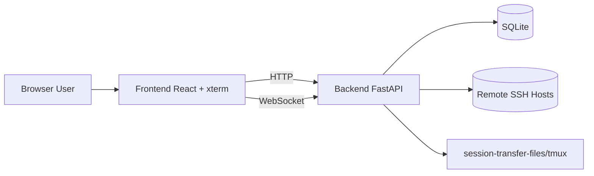

# Architecture (Community Edition)

> 中文版请见：[ARCHITECTURE.md](./ARCHITECTURE.md)

## 1. Overview

WebSSH Gateway follows a frontend-backend architecture:

- Frontend: user interaction, terminal UI, file and monitoring panels
- Backend: authentication, session orchestration, SSH bridge, and APIs

## 2. Backend Modules

- `app/main.py`: app bootstrap and route mounting
- `app/api/`: REST and WebSocket handlers
- `app/services/`: auth, crypto, SSH/session core logic
- `app/models/`: SQLAlchemy models
- `app/core/`: config, db, logging, state composition

## 3. Frontend Modules

- `src/pages/Login.tsx`
- `src/pages/Sessions.tsx`
- `src/pages/Terminal.tsx`
- `src/components/FileBrowser.tsx`
- `src/components/SystemMonitor.tsx`
- `src/lib/api.ts`
- `src/context/AppContext.tsx`

## 4. Critical Flows

- Auth flow: `/auth/login` -> JWT -> protected APIs
- Session flow: create session -> connect terminal WebSocket -> stream input/output
- Enhanced persistence: disconnected sessions are retried by background workers

### Terminal output scheduling

Each viewer has one ordered output writer with a bounded queue. Live bursts coalesce over approximately 8 ms, targeting batches of up to 64 Ki characters. A deque retains the latest 4,000 SSH chunks, capped at 8 MiB of UTF-8 data.

Clients negotiate the `webssh.output.v1` WebSocket subprotocol for `replay_start`, sequenced `output`, and `replay_end` envelopes. Snapshot and subscription registration happen without yielding, so live output follows replay in order. Reconnect resets the terminal and replays recent history; cross-connection incremental resume is not provided. Legacy clients continue receiving raw text.

The frontend parses 16 Ki character chunks serially through xterm and yields after eight writes or approximately 8 ms. Automatic device/color/cursor replies are suppressed during replay while keyboard input remains available. Output preserves the reading position and gives active scrolling/selection gestures priority. Server queues above 16 MiB or frontend queues above 16 Mi characters explicitly disconnect for a fresh replay rather than silently dropping ANSI data.

Scrollback defaults to 10,000 lines. Settings offer 5,000 / 10,000 / 50,000 / 100,000 lines, stored in the current browser and applied when reopening a terminal. This does not change server replay capacity. Existing TUI selection supports dragging across screens, and copied output remains plain text without ANSI sequences.

Rendering prefers hardware WebGL to batch dense colored glyphs, with Canvas fallback for software WebGL, browser restrictions, or context loss, and DOM fallback when Canvas is unavailable. TUI selection keeps one remote wheel request in flight and continues after verifying the viewport movement. Continuous output cannot indefinitely postpone this check, and pointer movement within the same cell does not redraw the selection. Remote scrolling remains subject to SSH round-trip time and TUI repaint speed.

## 5. Security Baseline

- AES-GCM encrypted credential storage
- JWT issuer validation
- Password policy and forced password change
- Lockout policy for repeated failed logins
- Request-id logging for traceability

## 6. CE vs Paid Edition

The Community Edition provides complete self-hosted core SSH gateway capabilities.
There is an intention to explore a paid development direction, while detailed scope, delivery model, and timeline are **TBD**.
Until then, CE continues as the independently deployable open-source edition.
