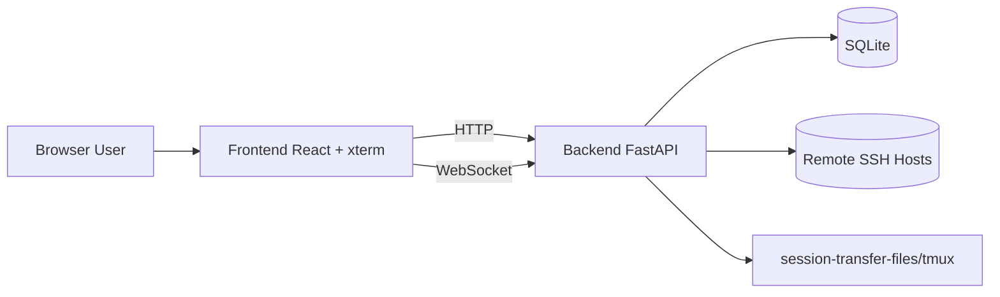

# Architecture (Community Edition)

> 中文版请见：[ARCHITECTURE.md](./ARCHITECTURE.md)

## 1. Overview

WebSSH Gateway follows a frontend-backend architecture:

- Frontend: user interaction, terminal UI, file and monitoring panels
- Backend: authentication, session orchestration, SSH bridge, and APIs

## 2. Backend Modules

- `app/main.py`: app bootstrap and route mounting
- `app/api/`: REST and WebSocket handlers
- `app/services/`: auth, crypto, SSH/session core logic
- `app/models/`: SQLAlchemy models
- `app/core/`: config, db, logging, state composition

## 3. Frontend Modules

- `src/pages/Login.tsx`
- `src/pages/Sessions.tsx`
- `src/pages/Terminal.tsx`
- `src/components/FileBrowser.tsx`
- `src/components/SystemMonitor.tsx`
- `src/lib/api.ts`
- `src/context/AppContext.tsx`

### 3.1 Interface System

`src/design.css` defines the Gateway presentation: oversized typography, an asymmetric sign-in composition, session cards, capsule navigation, and responsive layouts. `index.css` owns the neutral charcoal/white semantic palette, base styles, and accessibility rules; presentation styles do not override the palette. Legacy neutral/accent utilities use semantic tokens, and file selections use translucent accent backgrounds. `Brand`, `PageFrame`, and `WorkspaceIntro` share identity and typography. Overview counts reflect actual sessions; Resume work opens the most recently active online session. Session cards, Open buttons, keyboard entry and Resume work open independent tabs while preserving the list filters and position. The new tab inherits temporary-login session storage before its opener is detached; credentials never enter the URL. Blocked popups leave the list intact and show retry guidance. Overview and cards share a scrolling container on mobile. Keyboard actions inside cards do not trigger the outer navigation. Interface icons come from Lucide, including file and loading indicators.

`gatewayScene.ts` renders an original metallic ring with WebGL shaders, without external models or image services. Local WebP fallbacks exported from the same shader total about 72 KiB across both themes. Space Grotesk and IBM Plex Mono are self-hosted with their licenses. Large titles retain the display face; status bars, monitoring and project tools use system UI fonts with 13px main information, at least 12px supporting text, and 14px section headings. Neutral primary and secondary text reach at least 7:1 contrast on base surfaces; status colors retain their meaning. The terminal status bar wraps at narrow widths instead of shrinking text or crowding actions. `SignalArtwork` appears only on sign-in and the workspace overview. Pointer input drives a finite spring animation without per-frame React state updates. Hardware shader updates are limited to about 24 per second and an 840-pixel render size. Software WebGL redraws only on initial display, size or theme changes; pointer motion uses CSS transforms. Animation stops when settled, offscreen, hidden, or unmounted. Cleanup releases graphics resources and supports React StrictMode. Unavailable or lost WebGL contexts fall back to local, theme-aware images. Reduced-motion preferences disable movement.

The dark terminal uses #171717 with a shared #212121 toolbar and inspector (both #f9f9f9 in light mode); the light terminal remains #ffffff. Its frame reads the terminal palette directly to prevent edge seams. TUI panel slots 235/236 use lighter neutral gray layers: #2a2a2a/#303030 in dark mode and #f7f7f7/#ededed in light mode. ANSI status colors retain their meaning; scrolling, selection, output acknowledgements, and synchronization logic are preserved. Terminal pages do not mount the decorative scene. Browser regressions cover both themes, mobile and English layouts, forms, files, notifications, card keyboard actions, motion settling, and graphics fallback.

The original Open Gate mark combines an open G-shaped gateway with a terminal prompt. `Brand` uses a CSS mask with the theme accent and keeps the wordmark as accessible text. A separate SVG favicon has optical adjustments for small sizes and follows the browser color scheme. Production pages load only the final assets; see the [brand kit](brand/README.md) for the design notes, six concepts, and local preview.

### 3.2 Session Project Directory and Git Status

`GET /system/project/{session_id}?include_git=true` checks session ownership and liveness before reading metadata. `project_context.py` serializes requests per session and caches results for two seconds. `project_runtime.py` runs with Python's standard library on the SSH target, without installation or CLI configuration changes. Enhanced sessions use their exact tmux pane PID. On Linux, only the current account's processes are inspected; foreground interactive CLIs take precedence over temporary tool subprocess directories. Regular SSH uses its transport's sshd ancestry to identify a unique terminal, returning unavailable when ambiguous. Git queries use a separate SSH connection. tmux directory metadata provides a fallback outside Linux.

Git reads `status --porcelain=v2 -z`, `diff --numstat -z`, and local refs, with optional index locks and fsmonitor disabled and external diff/textconv disabled. No network Git commands run and remote URL credentials are never returned. Tracked line totals compare the working tree against HEAD, or the empty tree before the initial commit. Untracked files, binary files, conflicts, detached HEAD, and missing remotes are separate states. Lists display at most 100 files and 100 branches. Commands share a six-second budget and each output is limited to 512 KiB; exceeding a limit reports unavailable instead of zero changes. Parsing and counts follow the official [Git diff](https://git-scm.com/docs/git-diff) and [Git status](https://git-scm.com/docs/git-status) formats.

`useSessionProject` queries only while Files or Git is open and the page is visible, waiting 2.5/4 seconds after each response. Closing, hiding, disconnecting, or changing sessions cancels requests; old responses cannot replace a new session. The file browser uses a single directory/file list, without loading a separate system-root tree or guessing paths from prompt text. Refresh is the only persistent toolbar action; context menus and drag-and-drop retain file operations. Recognized foreground CLIs scope navigation to their synchronized directory and descendants, with a read-only path and no parent entry beyond that root. This is a frontend navigation scope, not a server permission boundary. A shell with a resolved directory still allows manual path entry. Unknown paths, lookup failures and disconnections show a waiting/retry state instead of loading the system root. Directory changes trigger following, deferred during file dialogs and transfers; polling an unchanged directory preserves subdirectory browsing. Only the latest directory-list response can update the list, so old results cannot replace a new project. Git presentation is read-only; expanding the branch list does not check out a branch.

## 4. Critical Flows

- Auth flow: `/auth/login` -> JWT -> protected APIs
- Session flow: create session -> connect terminal WebSocket -> stream input/output
- Enhanced persistence: disconnected sessions are retried by background workers

Ctrl/Cmd+V and Ctrl+Shift+V retain the browser's native paste event instead of forwarding Ctrl+V to the remote clipboard. Text uses xterm's `paste` API for newline normalization and bracketed paste. The server tracks bracketed-paste state independently of bounded history, ignoring OSC/DCS payloads, and restores it through replay_end metadata after history is parsed. This does not send remote input; older servers without the field retain existing behavior. CLI applications create their native attachment labels from separate path paste events. Clipboard images take precedence over accompanying text metadata and upload through the ownership-checked `/system/clipboard-image/{session_id}` endpoint, with a 20 MiB per-image limit and PNG/JPEG/WebP/GIF signature checks. A separate SSH connection streams the bytes into a random private `/tmp/webssh-clipboard.*/image.*` file (directory 0700, file 0600), without SFTP or X11, and the frontend pastes each remote path separately. See [official OpenAI image-input documentation](https://learn.chatgpt.com/docs/image-inputs?surface=cli) for Codex image inputs.

Pastes stay ordered while images upload, and Enter cannot submit prematurely. Timeouts, upload errors and connection changes report a retryable failure rather than injecting an old path into a new connection. Closing the terminal aborts pending uploads. Successful files remain on the SSH target for the remote program to read; the target's temporary-directory policy controls later cleanup.

Each terminal WebSocket has a resize queue that serializes SSH/tmux size commands and retains only the latest pending size, keeping keyboard and wheel input flowing while a resize waits. Disconnect cancels unfinished resize work. The header labels browser-to-gateway HTTP health-check latency as "Web" and gateway-to-target command-probe latency as "SSH". Both include request processing and neither measures complete key-to-display latency.

Task notifications use a separate application-level `/notifications/ws` connection, authenticated through the JWT subprotocol and isolated by user. A bounded observer reads live OSC 7501, OSC 9, restricted OSC 777, and standalone BEL without changing terminal bytes, sequence numbers, acknowledgements, or replay. It does not infer completion from silence or conversation text. String terminators, titles, color queries, progress indicators, links, and opaque control strings are not bells. Codex state and native completion notifications are combined; Claude's native main-session `done` takes precedence over Stop hooks, and named background-task status is excluded. Hooks provide a compatibility path when native status is unavailable.

Bounded queues and database work in a worker thread isolate notification handling from terminal output. The inbox retains at most 200 events per user for seven days, cleaning expiry on writes, startup, and hourly. Records contain the event type, session identity/name, and read time, without conversation text. This retention does not add terminal-history persistence. Initial connections, reconnects, and recovery from slow clients send silent snapshots. Read receipts synchronize across devices. The browser considers only fresh events for sound and uses IndexedDB transactions to claim each sound across tabs. Bursts prioritize user intervention. Sound preferences are local to the device; explicit activation/preview handles autoplay restrictions, and audio failure/suspension is reflected in settings. Notifications do not move terminal focus, viewport, or selection.

Remote setup runs only when the user selects **Configure CLI notifications**. It preflights, backs up, and merges the three Codex TUI notification settings and Claude hooks, writes atomically with rollback, and removes only managed handlers/settings that have not since been edited. Automatic setup requires Codex 0.163.0+ or Claude Code 2.1.306+; those are the versions exercised locally. Targets need Python 3.8+, and Codex configuration needs Python 3.11+. Separate configuration homes retain separate originals, and setup checks inspect actual settings instead of trusting a manifest. Claude hooks return `terminalSequence` through the CLI; delayed permission notifications reuse the original request ID. When another user/project Stop handler is detected, completion falls back to native status rather than potentially reporting before a continuation hook. Custom continuation hooks supplied through extra CLI settings or plugins need separate verification. Claude can load new hooks while running; setup does not restart existing programs.

Existing-session observation uses a separate cancellable SSH exec channel. On Linux, the tmux pane PID or the SSH connection's terminal process identifies the foreground CLI and its actual configuration home; only the current user's processes are inspected. Open foreground-session records form the Codex candidate set. A directly owned record or explicit resume ID permits automatic binding; shared-daemon ambiguity requires user selection, never a guess based on modification time. Process identity or candidate-set changes invalidate bindings. Incremental reads start at EOF, are limited to 256 KiB per poll and 1 MiB per record, and forward only explicit `task_complete` events with stable session/turn identities. Transcript bodies, tool output, cancellation, and intermediate tool completion are not forwarded. A bound record takes precedence over native completion to prevent duplication; questions/approvals still need explicit waiting signals. Runtime state and actual-event verification share the notification socket. Disconnect and undo stop the auxiliary process independently of terminal output and ACK handling.

Three sine partials produce a light glass chime with a 4ms attack and natural decay; upper harmonics fade first. Completion uses a rising pair lasting about 0.61 seconds, questions/approvals use three strikes lasting about 0.83 seconds, and generic terminal bells use one strike. The output gain multiplier is 0.48, with full-volume waveform checks for peak headroom. Stopping or replacing audio fades out for 8ms and cancels pending notes to avoid cutoff clicks and stacking. New devices default to 60%; existing preferences are preserved. Previewing does not enable the sound switch.

tmux filters some OSC 7501 messages. Enhanced-session setup installs a pane-specific pipe that relays only short state/capability envelopes, without storing ordinary output. Existing user pipes are preserved rather than overwritten. Undo closes the managed pipe and restores the original passthrough value/inheritance if it was not edited again. Some tmux versions finish capability probing with their own local answer before an external response arrives; Claude then uses the hook path, whose completion behavior with unverified custom continuation hooks must not be assumed. Frozen browsers, sleeping/locked devices, closed pages, and disconnected gateway SSH transports cannot guarantee prompt sound. This release does not implement background push or system desktop notifications.

New clients send a `ping` every five seconds over the existing terminal WebSocket. A matching `pong` enables a preferred "Terminal" round-trip indicator, with the HTTP health-check value in its tooltip. Older servers without pong support retain the "Web" HTTP fallback. One probe can be outstanding; a 15-second timeout clears stale readings, and hidden tabs do not sample. Pongs use the same output writer, with one bounded pending response that can pass queued output but cannot interrupt a send already in progress. This measurement includes browser/gateway scheduling and excludes SSH, Codex processing, and terminal parsing/painting.

### Terminal output scheduling

Each viewer has one ordered output writer with a bounded queue. Live bursts yield once to coalesce ready SSH output without imposing a fixed 8 ms delay on keyboard echoes, targeting batches of up to 64 Ki characters. A deque retains the latest 4,000 SSH chunks, capped at 8 MiB of UTF-8 data.

Clients negotiate the `webssh.output.v1` WebSocket subprotocol for `replay_start`, sequenced `output`, and `replay_end` envelopes. Snapshot and subscription registration happen without yielding, so live output follows replay in order. Reconnect resets the terminal and replays recent history; cross-connection incremental resume is not provided. Legacy clients continue receiving raw text.

The frontend parses 16 Ki character chunks serially through xterm and yields after eight writes or approximately 8 ms. Automatic device/color/cursor replies are suppressed during replay while keyboard input remains available. Output preserves the reading position and gives active scrolling/selection gestures priority. Server queues above 16 MiB or frontend queues above 16 Mi characters explicitly disconnect for a fresh replay rather than silently dropping ANSI data.

An idle frontend writer starts immediately. Small packets and their completion callbacks share writes; empty records preserve replay/reset barriers. The first wheel report is sent immediately, subsequent reports are batched per frame in order, and keyboard input flushes pending wheel reports first. TUI selection snapshots reuse column offsets for unchanged text while retaining distinct identities for duplicate rows. Long selections update row positions and capacity incrementally instead of rescanning the full captured document on each scroll.

Repeated text alone does not invalidate a repaint. Partial-repaint checks look for stale rows at the entering edge of a matched scroll. A synchronized repaint end allows legitimate repeated rows at that edge, so long selections continue through repeated content while partial or ambiguous movement remains protected.

Scrollback defaults to 10,000 lines. Settings offer 5,000 / 10,000 / 50,000 / 100,000 lines, stored in the current browser and applied when reopening a terminal. This does not change server replay capacity. Existing TUI selection supports dragging across screens, and copied output remains plain text without ANSI sequences.

Rendering prefers hardware WebGL to batch dense colored glyphs, with Canvas fallback for software WebGL, browser restrictions, or context loss, and DOM fallback when Canvas is unavailable. TUI selection keeps one remote wheel request in flight and continues after verifying the viewport movement. Continuous output cannot indefinitely postpone this check, and pointer movement within the same cell does not redraw the selection. Remote scrolling remains subject to SSH round-trip time and TUI repaint speed.

Terminal themes are applied locally without restarting the TUI. Default body text and the cursor use pure white #ffffff in dark mode and pure black #000000 in light mode; colored code and dim information retain their distinction. Both palettes map panel slots 235/236. Dark mode targets 4.5 contrast for ordinary text and 3 for dim text after blending at 72% opacity. Light mode targets 7 for ordinary text; dim text is first blended with its actual background at 80% opacity, then corrected to a final contrast of at least 4.5. Light surfaces also reserve 4.5 contrast under the independent selection overlay. Default dim text on white becomes approximately #333333. Basic ANSI, indexed and RGB accents gain saturation, then adjust lightness at a fixed hue and saturation to meet contrast targets. Neutral body text remains neutral. Backgrounds that cannot meet the target use the best achievable contrast. Default, indexed and RGB foregrounds, inverse/bold attributes and actual cell backgrounds are supported; non-text graphics retain upstream behavior. Each WebGL glyph atlas owns its contrast caches so idle warmup from an old theme cannot contaminate the new palette.

DOM and WebGL share `terminalContrast.ts` at final glyph color resolution and cache the result. ANSI attributes, including dim, remain intact in output and history. During development startup and production builds, a Vite plugin generates an in-memory module from pinned xterm 6.0.0 / WebGL 0.19.0 sources. It does not modify node_modules or require committed generated vendor bundles. Package versions, replacement locations and the number of patched files are checked; incompatible dependency changes fail the build. Theme/contrast changes clear both normal and dim contrast caches. Selection color also participates in WebGL atlas configuration comparisons so existing content updates correctly.

Before parsing, a streaming adapter maps neutral backgrounds near black or white to the two panel slots: channel spread at most 24, with all channels at most 72 or at least 224. This supports indexed and RGB panels emitted by Codex started in either theme. Foregrounds, saturated backgrounds, middle grays, text and OSC/DCS/APC payloads retain their semantics. Incomplete CSI buffering is limited to 512 characters and reset at the replay barrier; server history and protocol acknowledgements remain based on raw output. Theme switches reuse the terminal, viewport, history and selection. During DEC 2026 the latest requested theme waits for a complete frame or the core's timeout recovery. Connecting, reconnecting and theme changes never inject unsolicited OSC 10/11/12 color replies into remote input. Themes are rendered locally; replayed queries remain silent, while xterm still answers live application queries.

## 5. Security Baseline

- AES-GCM encrypted credential storage
- JWT issuer validation
- Password policy and forced password change
- Lockout policy for repeated failed logins
- Request-id logging for traceability

## 6. CE vs Paid Edition

The Community Edition provides complete self-hosted core SSH gateway capabilities.
There is an intention to explore a paid development direction, while detailed scope, delivery model, and timeline are **TBD**.
Until then, CE continues as the independently deployable open-source edition.
