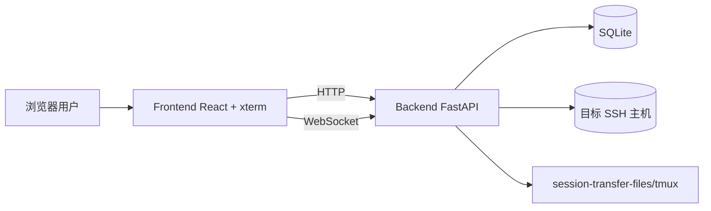

# 架构说明（社区版）

> English version: [ARCHITECTURE.en.md](./ARCHITECTURE.en.md)

## 1. 总体架构

WebSSH Gateway 采用前后端分离架构，后端负责鉴权、SSH 会话和业务 API，前端负责会话交互、可视化和文件操作。

## 2. 后端模块拆分

- `app/main.py`：应用启动、路由注册、静态资源挂载、会话状态初始化。
- `app/api/`：REST + WebSocket 接口层。
- `app/services/`：鉴权、加密、SSH 会话管理、会话状态广播等核心业务。
- `app/models/`：SQLAlchemy 模型（用户、连接、会话）。
- `app/core/`：配置、数据库、日志、应用状态装配。

### 2.1 接口分层

- `auth.py`：登录、改密。
- `connections.py`：连接管理（增删改查）。
- `sessions.py`：会话创建、查询、重试、断开、备注、终端 WebSocket。
- `ws_sessions.py`：会话状态广播 WebSocket。
- `system.py`：系统监控 + 文件管理能力。
- `health.py`：健康检查。

## 3. 前端模块拆分

- `src/pages/Login.tsx`：登录页。
- `src/pages/Sessions.tsx`：连接与会话管理页。
- `src/pages/Terminal.tsx`：终端页（xterm + 文件侧栏 + 系统监控）。
- `src/components/FileBrowser.tsx`：远程文件操作 UI。
- `src/components/SystemMonitor.tsx`：监控面板。
- `src/lib/api.ts`：统一 API 封装、错误处理、鉴权头处理。
- `src/context/AppContext.tsx`：主题与网络状态上下文。

## 4. 核心数据流

### 4.1 登录与鉴权

1. 前端调用 `/auth/login`。
2. 后端校验用户名密码、失败次数与锁定状态。
3. 返回 JWT，前端存储在 `localStorage` 或 `sessionStorage`。
4. 后续请求通过 `Authorization: Bearer <token>` 访问受保护 API。

### 4.2 终端会话

1. 前端创建会话 `/sessions`。
2. 后端解密连接凭据，建立 SSH 连接并创建 PTY。
3. 前端连接 `/sessions/ws/terminal/{session_id}`。
4. 终端输入通过 WebSocket 下发到 SSH，输出实时回传。

Ctrl/Cmd+V 与 Ctrl+Shift+V 保留浏览器的粘贴事件，不把 Ctrl+V 控制字符转发给远端读取剪贴板。文本通过 xterm 的 `paste` API 发送，保留换行规范化和远端 bracketed-paste 模式。剪贴板图片优先于同时存在的文本元数据，经带会话所有权校验的 `/system/clipboard-image/{session_id}` 上传；单张上限 20 MiB，校验 PNG/JPEG/WebP/GIF 类型及文件头。图片通过独立 SSH 连接的二进制 stdin 写入随机私有 `/tmp/webssh-clipboard.*/image.*` 文件（目录 0700、文件 0600），无需 SFTP 或 X11，再将路径逐张粘贴到终端。Codex 图片输入方式见 [OpenAI 官方文档](https://learn.chatgpt.com/docs/image-inputs?surface=cli)。

图片上传期间保留后续粘贴的顺序，阻止 Enter 提前提交；上传超时、失败或连接变化时提示重试，不向新连接注入旧图片路径。关闭终端会取消待完成上传。成功上传的图片保留在目标机器的临时目录供远端程序读取，后续清理由目标系统的临时目录策略负责。

每个终端 WebSocket 使用独立的尺寸更新队列，串行执行 SSH/tmux 尺寸命令，等待期间合并为最新尺寸，避免阻塞后续键盘与滚轮输入；连接断开时取消未完成的尺寸任务。顶部“网页”延迟来自浏览器到网关的 HTTP 健康检查，“SSH”延迟来自网关到目标的命令探测。两者均包含对应请求的处理耗时，不代表按键到画面显示的完整延迟。

支持探测的新客户端每 5 秒在终端现有 WebSocket 上发送一次 `ping`，收到匹配的 `pong` 后，顶部优先显示“终端”往返延迟；原 HTTP 健康检查值保留在提示中。旧服务端不回复时继续显示“网页”HTTP 探测，不能将其等同于终端长连接延迟。探测只保留一个未完成请求，15 秒超时后清除旧值，后台标签页不采样。`pong` 使用同一个输出 writer 发送，最多保留一个待发回复，可越过排队的输出片段但不会打断正在发送的消息。该指标包括浏览器和网关调度，不包括 SSH、Codex 处理和终端解析/绘制。

终端输出由每个浏览器连接独立的有界 writer 顺序发送，实时片段让出一次事件循环以合并已就绪的 SSH 输出，不再为每次输入回显固定等待 8 ms，单批目标上限为 64 Ki 字符。历史缓冲使用 deque，保留最近 4,000 个片段，且不超过 8 MiB UTF-8 数据。

新客户端协商 `webssh.output.v1` 子协议，以 `replay_start`、带 `seq` 的 `output` 和 `replay_end` 划定历史与实时输出边界。订阅和历史快照在同一事件循环操作中完成，避免回放与实时输出交错；重连会重置终端并回放近期历史，不提供跨连接的增量续传。未协商子协议的旧客户端继续接收原始文本。

前端以 16 Ki 字符块串行交给 xterm，每轮最多处理 8 次写入或约 8 ms 后让出主线程。回放期间抑制终端自动设备/颜色/光标应答；真实键盘输入仍可发送。输出更新保留当前阅读位置，用户正在滚动或拖动选区时优先处理用户操作。服务端待发送队列超过 16 MiB，或前端待解析队列超过 16 Mi 字符时，会显式断开并重新回放，避免静默丢弃 ANSI 数据。

空闲输出队列收到数据后立即交给 xterm；小片段及其完成通知一起合并，空记录保留回放/重置屏障。滚轮首个事件立即发送，连续事件按帧合并并保持顺序，键盘输入先冲刷待发送滚轮。TUI 选区快照复用未变文本的列偏移，保留重复行独立身份；扩展长选区时增量更新位置索引和容量统计，避免每次滚动重新扫描全部已选内容。

重复文本本身不再作为整帧未完成重绘的依据；分片重绘只检查新进入边缘是否仍留着旧行。收到同步重绘结束标记后，允许边缘出现合法重复行，避免长距离拖选在重复内容处停住，同时保留对半帧和无法确认位移的画面的保护。

终端历史默认保留 10,000 行，可在系统设置中选择 5,000 / 10,000 / 50,000 / 100,000 行。该偏好仅保存在当前浏览器，保存后重新打开终端生效，不改变服务端回放缓冲大小。选择与复制继续使用现有 TUI 跨屏选择逻辑，复制结果保持纯文本，不包含 ANSI 控制序列。

渲染器优先使用硬件 WebGL，将密集彩色字符合批绘制；检测到软件 WebGL、浏览器限制或图形上下文丢失时回退到 Canvas，Canvas 不可用时保留 DOM 渲染。TUI 拖选每次只发送一个远端滚轮请求，确认画面移动后继续；持续输出不会无限重置画面检查计时，同一单元格内移动也不会重复刷新选区。远端滚动仍受 SSH 往返和 TUI 重绘速度影响。

### 4.3 增强会话持久化

增强模式依赖 `session-transfer-files/tmux` 下的保活二进制与远端 `tmux`。

- 会话断开后会进入 `disconnected` 状态。
- 后台 worker 基于重试间隔策略自动尝试恢复。
- 恢复成功后状态回推给前端。

## 5. 存储模型

- `users`：用户、密码哈希、锁定状态、最后登录时间。
- `connections`：SSH 连接信息、凭据密文、远端平台信息。
- `sessions`：会话状态、PTY 信息、增强模式参数、重试计数等。

## 6. 安全设计

- 凭据加密：连接凭据使用 AES-GCM 加密后持久化。
- 密码策略：要求复杂度并支持首次登录强制改密。
- 登录风控：失败次数达到阈值后短时锁定。
- API 鉴权：JWT + issuer 校验。
- 日志追踪：请求级 request-id，便于审计与定位。

## 7. 社区版与付费版边界

当前社区版提供“可独立部署的完整基础能力”。

项目后续存在付费开发方向意向，但具体能力范围、交付形式与时间计划 **待定**。
在此之前，社区版持续作为可独立部署的开源版本演进。
